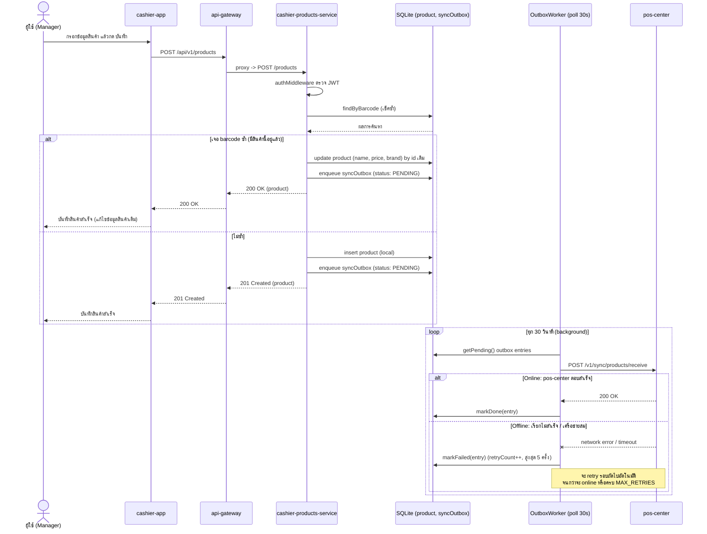

# Product — create — offline mode / online mode

[← กลับไปหน้ารวม](./README.md)

ส่วนหน้าบ้าน (foreground) เหมือนกันทั้ง offline/online: บันทึกสินค้าลง SQLite local แล้วตอบกลับผู้ใช้ทันที พร้อมกับ enqueue รายการเข้า `syncOutbox` การ sync ไป `pos-center` เกิดขึ้นภายหลังโดย `OutboxWorker` (poll ทุก 30 วินาที) — จุดนี้คือจุดที่ offline/online แยกออกจากกัน

**Config `APP_MODE` (`cashier-products-service/.env`):** `online` (default) เริ่ม `OutboxWorker` ตามปกติ, `offline` จะไม่เริ่ม worker เลย (ไม่มีการพยายามยิงออก `pos-center` แม้แต่ครั้งเดียว) รายการใน `syncOutbox` ยังถูก enqueue ตามปกติและรอ sync เมื่อรีสตาร์ทเซอร์วิสเป็นโหมด `online`

**กรณีเช็คแล้วซ้ำ (barcode ซ้ำ) — upsert:** `CreateProductUseCase` เช็คด้วย `findByBarcode` ก่อนเสมอ ถ้าพบว่ามีสินค้าที่ barcode นี้อยู่แล้วจะ **อัปเดต name / price / brand ของสินค้าเดิม (คง `id` เดิมไว้)** แล้ว enqueue เข้า `syncOutbox` เหมือนกรณีสร้างใหม่ เพื่อ push การแก้ไขขึ้น `pos-center` — ตอบกลับ `200 OK` (กรณีสร้างใหม่ตอบ `201 Created`) ทั้งนี้ brand ที่ไม่ได้ส่งมาจะถูกเคลียร์เป็น `null`

