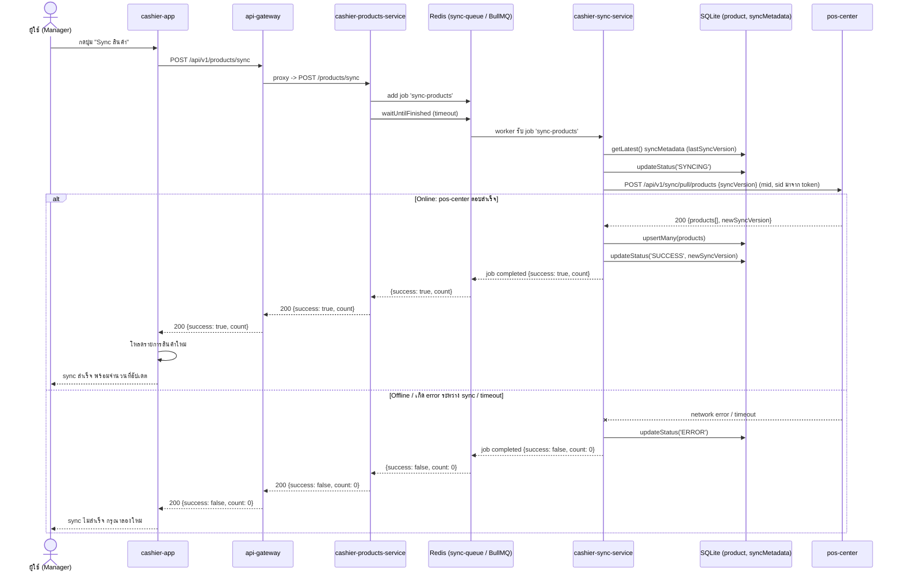

# Product — sync — online mode

[← กลับไปหน้ารวม](./README.md)

ทิศทางตรงข้ามกับ create/edit: ดึงข้อมูลสินค้าจาก `pos-center` เข้ามาที่เครื่อง local (pull) สั่งงานด้วยตนเองผ่านปุ่ม "Sync" บนหน้าจอ ต้องออนไลน์เท่านั้น หากล้มเหลวจะถือเป็นความล้มเหลวของการ sync ครั้งนั้น (ไม่มี fallback แบบ offline)

งานดึงสินค้าจริงทำอยู่ที่ `cashier-sync-service` — `cashier-products-service` แค่ enqueue job `sync-products` เข้า `sync-queue` (BullMQ) แล้วรอผลด้วย `job.waitUntilFinished` (timeout `SYNC_PRODUCTS_TIMEOUT_MS`, default 60s) เพื่อให้ API ยังตอบ `{success, count}` แบบ synchronous เหมือนเดิม

**Config `APP_MODE`:** ถ้า `cashier-products-service` ตั้งเป็น `offline` จะไม่ enqueue job เลย ตอบกลับ `{success: false, count: 0}` ทันที; ถ้า `cashier-sync-service` เป็น `offline` จะไม่มี worker มารับ job → รอจน timeout แล้วตอบ `{success: false, count: 0}` (job ถูกลบออกจาก queue)

