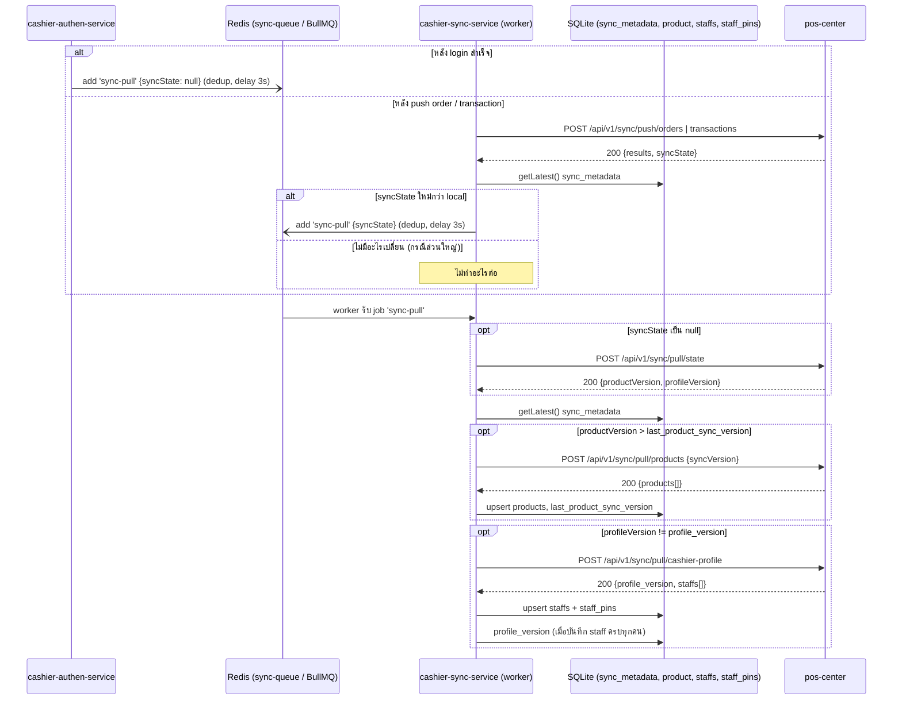

# Sync pull — อัตโนมัติหลัง login / หลังขาย — online

[← กลับไปหน้ารวม](./README.md)

ดึงสินค้าและ cashier profile (staff + PIN) จาก `pos-center` **เฉพาะเมื่อมีการเปลี่ยนแปลง** โดยไม่ต้องกดปุ่ม sync เอง ทำงานเบื้องหลังทั้งหมด login และ checkout ไม่ต้องรอ

หลักการคือเทียบเวอร์ชันก่อนค่อยดึง ซึ่งถูกมาก:

- `pos-center` ให้ 2 ค่า (`POST /api/v1/sync/pull/state` หรือ `syncState` ที่แนบมากับ response ของ push order/transaction/products)
  - `productVersion` — max `sync_version` ของสินค้าใน store ถ้า > `sync_metadata.last_product_sync_version` → pull products
  - `profileVersion` — fingerprint ของ cashier profile ถ้า != `sync_metadata.profile_version` → pull cashier-profile แล้วเก็บ `profile_version` ใหม่
- ตัวกระตุ้น
  - **login สำเร็จ** — `cashier-authen-service` enqueue `sync-pull` (ไม่มี `syncState` → job เรียก pull state เอง) ไม่รอผล และ login ไม่ fail ถ้า enqueue ไม่ได้
  - **หลัง push order/transaction** — `cashier-sync-service` เทียบ `syncState` ใน response กับ SQLite local ก่อน (ไม่มี request เพิ่ม) enqueue `sync-pull` เฉพาะเมื่อมีอะไรเปลี่ยน ปกติไม่มี → ไม่มี job
- รวมงาน (BullMQ `deduplication` id `sync-pull`, `replace`, `keepLastIfActive`, `delay` = `SYNC_PULL_DELAY_MS` default 3s): มีได้แค่ 1 job รอ + 1 job กำลังทำ การขายหรือ login ติดกันหลายครั้งจึงกลายเป็นการ pull ครั้งเดียว

**Config `APP_MODE`:** `offline` ที่ `cashier-authen-service` จะไม่ enqueue ตอน login; `offline` ที่ `cashier-sync-service` ไม่มี worker จึงไม่มีการ push และ pull

**ปุ่ม Sync staff** (`POST /api/v1/authen/staffs/sync`) ก็ย้ายมาใช้ queue เหมือนปุ่ม sync สินค้า: `cashier-authen-service` enqueue job `sync-staffs` แล้วรอผล (`SYNC_STAFFS_TIMEOUT_MS`, default 60s) ตัว pull cashier-profile ทำที่ `cashier-sync-service` ที่เดียว และเก็บ `profile_version` ด้วย

